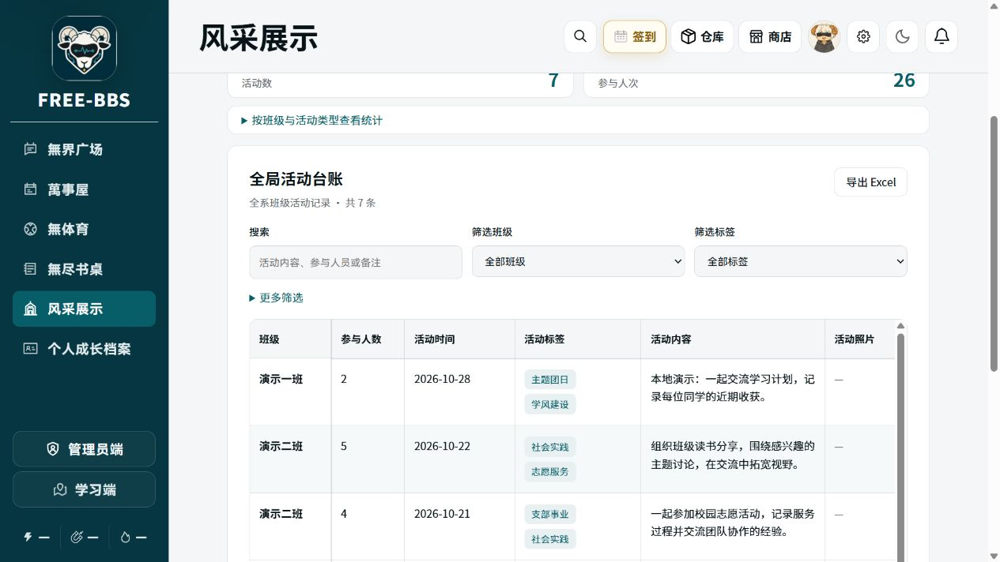
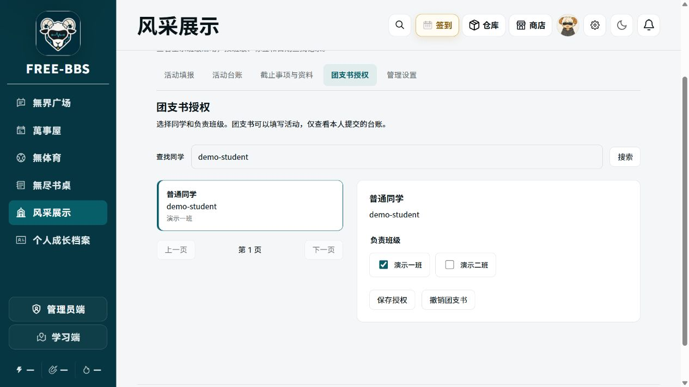
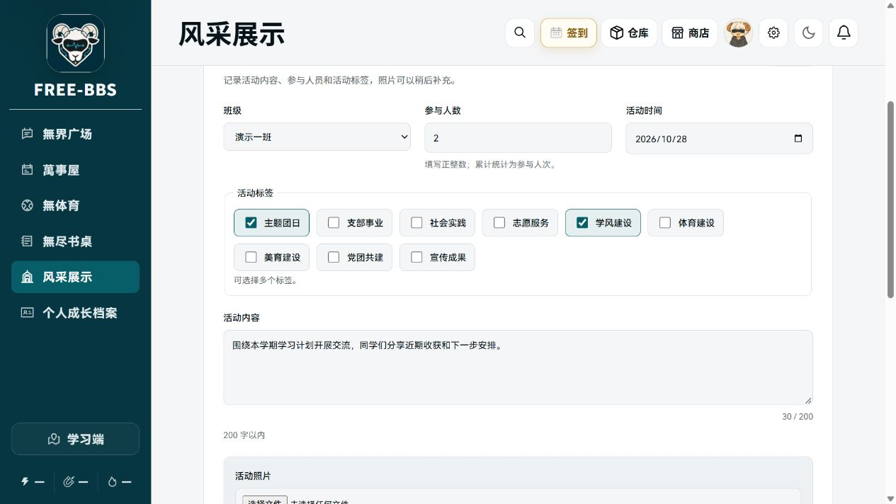
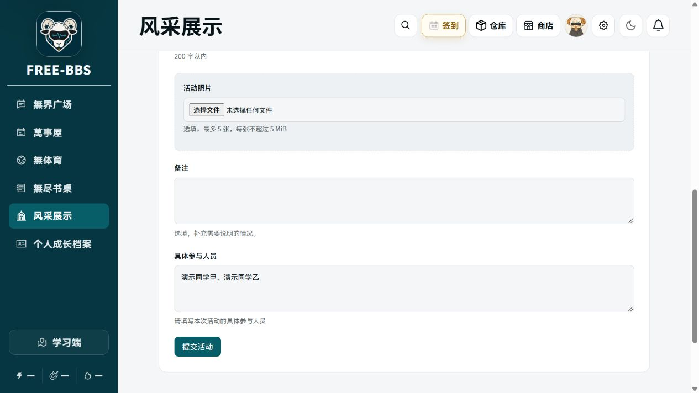

# 组织组活动台账操作指南

[下载图文版 Word](./organization-group-user-guide.docx)

## 一 查看全局台账

1. 登录 FREE BBS，进入发展端，依次点击“风采展示 → 团委 → 组织组 → 班级活动台账”。也可直接打开[组织组活动台账](https://www.free-bbs.cn/development/organizations/youth_league/organization/ledger)。

2. 组织组同学进入后默认看到“活动台账”，显示全系班级提交的活动。先在右上方选择需要查看的“学年”。
3. 使用“筛选班级”“筛选标签”查找记录；搜索框可查活动内容、参与人员或备注。“更多筛选”中可设置活动日期起止和排序。筛选后，表格和统计会同步更新。
4. 点击某条记录的“查看详情”，查看完整内容和照片；照片可点击“预览”或“下载”。点击“导出 Excel”可导出当前筛选结果的全部记录，不限当前一页；原图仍在记录详情中查看。

组织组同学均可查看全局、给团支书授权。查看全局不代表可以替别人修改记录。

## 二 给团支书授权

1. 在台账页面点击“团支书授权”。请先让团支书注册好 FREE BBS 账号，并提供准确的用户名或学号。
2. 在“查找同学”中输入用户名或学号，点击“搜索”；也支持按姓名或 UID 搜索。点选对应账号，核对用户名和学号，避免同名误选。

3. 在“负责班级”中勾选其负责的班级，点击“保存授权”。看到“团支书授权已保存”后，通知该同学刷新页面或重新登录。兼任多个班级时可多选。
4. 授权完成后，请团支书打开“活动填报”，确认班级选项正确，再开始填报。若班级列表为空或缺少班级，请联系管理员补充。
5. 调整负责班级时，重新勾选并点击“保存授权”；撤任时点击“撤销团支书”。换届请撤销原任，再给新任授权。历史记录保留原填报人，不会转到新任名下。

若提示授权已更新，点击“重新加载授权”，核对最新班级后再保存。组织组只需在这里维护团支书，无需进入管理员端。

## 三 指导团支书填写和查看本人记录

请团支书使用本人账号进入同一台账入口，按以下步骤操作：

1. 选择正确“学年”，点击“活动填报”。每次活动提交一条记录，按实际情况填写：
   - **班级、参与人数、活动时间**：必填。班级只能选已授权班级；人数填写正整数；日期填写实际活动日期。
   - **活动标签**：必填，可多选符合活动情况的标签。
   - **活动内容**：必填，200 字以内，空格和换行也计入字数。
   - **活动照片**：选填，最多 5 张，每张不超过 5 MiB，支持 JPG、PNG、WebP。
   - **备注**：选填，最多 2000 字。
   - **具体参与人员**：必填，直接填写姓名，最多 4000 字，可用顿号、逗号、空格或换行分隔。

2. 核对信息和照片，点击“提交活动”。看到“活动已提交，可以继续填报下一次活动。”即表示提交成功。人数核对提示仅供检查，不影响提交。

3. 点击“活动台账”，以表格查看本人提交的记录，也可按标签、日期筛选和搜索。这里只显示本人记录，不显示同班其他同学提交的内容。
4. 需要更正时，点击“查看详情 → 编辑我的活动”，修改后点击“保存修改”。若没有编辑按钮，可能是学年已归档、修改已关闭、记录被锁定或班级授权已调整，请联系组织组核实。

若无法填报，先确认登录账号是否与授权账号一致，再联系组织组核对班级授权。
